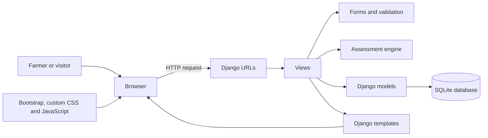
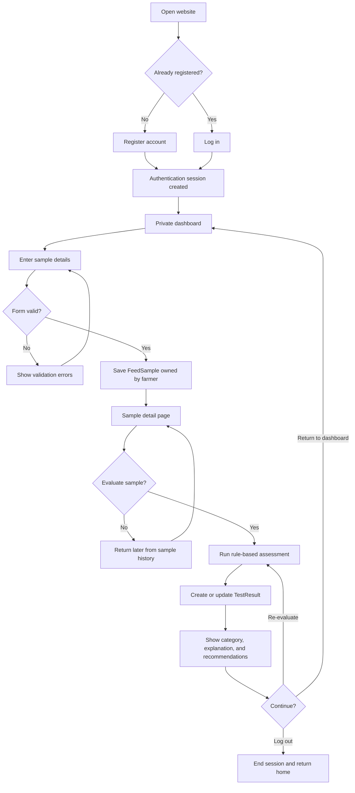
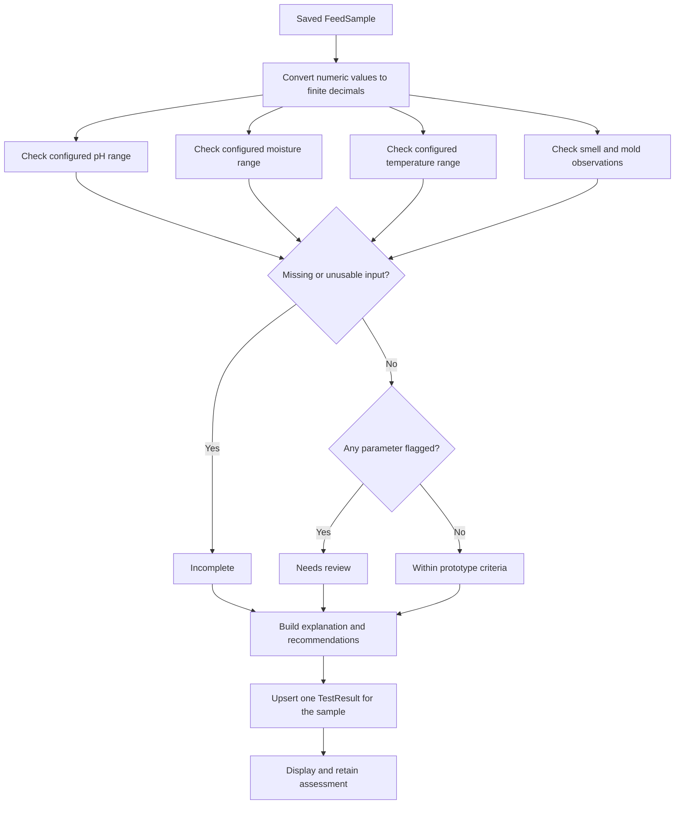
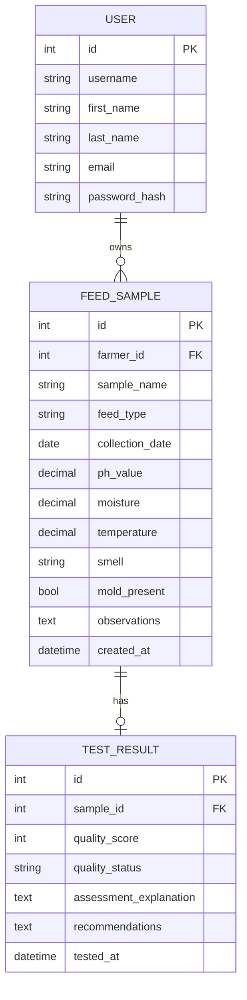

# NutriFarm AI

A Django-based prototype for recording, organizing, and reviewing dairy feed and silage samples. Farmers can create private accounts, submit sample measurements, review their sample history, and run an illustrative rule-based assessment.

> [!IMPORTANT]
> Despite the project name, the current assessment engine is **not a trained AI model**. Its checks use configurable rules and illustrative ranges. Results are not scientifically validated and do not certify feed quality or safety. Real decisions should rely on appropriate laboratory testing and qualified agricultural advice.

## Project at a Glance

- **Primary users:** Dairy farmers and site administrators
- **Backend:** Python, Django, SQLite
- **Frontend:** Django templates, Bootstrap 5, custom CSS and JavaScript
- **Authentication:** Django's built-in session-based authentication
- **Core records:** A farmer-owned `FeedSample` and an optional one-to-one `TestResult`
- **Assessment:** Configurable, rule-based checks for pH, moisture, temperature, smell, and visible mold
- **Current status:** Functional prototype with sample submission, private history, assessment, dashboard, and admin management

## Main Features

- Farmer registration and login
- Private farmer dashboard with sample and tested-sample counts
- Feed and silage sample submission with server-side validation
- Sample history and detailed sample pages
- On-demand assessment and re-assessment of saved samples
- Parameter-specific explanations and recommendations
- Per-farmer data isolation
- Django admin management for sample and result records
- Public home, about, features, and contact pages

## System Architecture



### Application Responsibilities

- `nutrifarm/` — project settings, root URL configuration, and WSGI/ASGI entry points
- `core/` — public homepage
- `testing/` — account flows, sample forms, sample management, assessment logic, models, admin configuration, and most tests
- `templates/` — shared layout and all page templates
- `static/` — custom presentation and browser-side behavior
- `testing/migrations/` — database schema history
- `db.sqlite3` — local development database

## Complete Farmer Workflow



All dashboard, sample, and assessment pages require authentication. Sample detail and result queries also include the current user as the owner, so another farmer's record returns a 404 rather than exposing the record.

## Sample Submission Flow

A farmer supplies:

- Sample name or ID
- Feed type: silage, green fodder, dry fodder, hay, concentrate, or other
- Collection date
- pH value
- Moisture percentage
- Temperature in Celsius
- Smell condition
- Whether visible mold is present
- Optional observations

The form validates pH from 0 to 14, moisture from 0% to 100%, temperature from −20°C to 80°C, and rejects future collection dates. The stricter assessment ranges are separate: accepted input ranges prevent implausible values, but do not imply quality standards.

## Assessment Flow



The categories are:

- **Incomplete** — one or more inputs are missing or unusable
- **Needs review** — at least one configured check is flagged
- **Within prototype criteria** — no configured check is flagged

Re-evaluation uses Django's `update_or_create` behavior, so a sample continues to have at most one `TestResult`. The `quality_score` field exists for future expansion, but the current engine deliberately leaves it empty.

Default assessment criteria are configured in `nutrifarm/settings.py` and currently illustrate:

- pH: 5.0–7.5
- Moisture: 0%–80%
- Temperature: 0°C–40°C
- Review smells: strongly sour, musty, or rotten
- Any visible mold observation requires review

## Data Model



Deleting a user cascades to that user's samples. Deleting a sample cascades to its result.

## Request and Page Map

| Area | URL | Access | Purpose |
| --- | --- | --- | --- |
| Home | `/` | Public | Project introduction and workflow overview |
| About | `/about/` | Public | Project background |
| Features | `/features/` | Public | Feature overview |
| Contact | `/contact/` | Public | Contact page; POST currently returns `501` |
| Register | `/register/` | Public | Create a farmer account and log in |
| Log in | `/login/` | Public | Start an authenticated session |
| Log out | `/logout/` | POST only | End the session |
| Dashboard | `/dashboard/` | Authenticated | Counts and five recent owned samples |
| Submit sample | `/samples/submit/` | Authenticated | Validate and save a sample |
| Sample history | `/samples/` | Authenticated | List owned samples |
| Sample detail | `/sample/<id>/` | Owner only | View measurements and assessment action |
| Evaluate sample | `/sample/<id>/evaluate/` | Owner, POST only | Create or update the assessment |
| Sample result | `/sample/<id>/result/` | Owner only | View the assessment result |
| Django admin | `/admin/` | Staff/superuser | Manage sample and result records |

## Technology and Security

- Django 5.2 with the built-in ORM, forms, authentication, messages, sessions, and admin
- SQLite for local persistence
- Bootstrap 5 loaded from jsDelivr, plus project CSS and JavaScript
- `python-dotenv` for environment-based configuration
- Gunicorn included as a production WSGI server dependency
- CSRF protection on registration, login, sample submission, logout, and evaluation
- POST-only mutation actions for logout and assessment
- Hashed passwords and Django password validators
- Production options for HTTPS redirect, secure cookies, HSTS, proxy headers, content-type protection, referrer policy, secret key, and allowed hosts

## Local Setup

### Requirements

- Python 3.12 or newer
- Dependencies in `requirements.txt`

### Installation and Run

```powershell
py -m venv .venv
.\.venv\Scripts\Activate.ps1
python -m pip install -r requirements.txt
python manage.py migrate
python manage.py runserver
```

Open [http://127.0.0.1:8000/](http://127.0.0.1:8000/) in a browser.

To access Django admin, create a superuser:

```powershell
python manage.py createsuperuser
```

Then visit [http://127.0.0.1:8000/admin/](http://127.0.0.1:8000/admin/).

### Environment Configuration

Development can run without a `.env` file. A production deployment should provide at least:

```dotenv
DEBUG=False
SECRET_KEY=replace-with-a-strong-secret
ALLOWED_HOSTS=example.com,www.example.com
DJANGO_CSRF_TRUSTED_ORIGINS=https://example.com,https://www.example.com
```

Optional production settings include `SECURE_HSTS_SECONDS` and `SECURE_HSTS_INCLUDE_SUBDOMAINS`. The settings module also accepts the aliases `DJANGO_DEBUG`, `DJANGO_SECRET_KEY`, and `DJANGO_ALLOWED_HOSTS` for compatibility.

## Running Tests

```powershell
python manage.py test
```

The test suite covers:

- Public pages and the custom 404 page
- Registration, password hashing, login, logout, and CSRF
- Farmer-specific dashboard counts and privacy
- Sample validation, persistence, history, and ownership protection
- Assessment rules and missing-data behavior
- Assessment creation, re-assessment, POST-only execution, and privacy
- Django admin registration and sample CRUD
- The complete workflow from registration through evaluation and logout

## Project Structure

```text
nutrifarm.AI/
├── manage.py
├── db.sqlite3
├── requirements.txt
├── core/
│   ├── views.py
│   ├── urls.py
│   └── tests.py
├── nutrifarm/
│   ├── settings.py
│   ├── urls.py
│   ├── asgi.py
│   └── wsgi.py
├── testing/
│   ├── assessment.py
│   ├── forms.py
│   ├── models.py
│   ├── views.py
│   ├── urls.py
│   ├── admin.py
│   ├── tests.py
│   └── migrations/
├── templates/
│   ├── base.html
│   ├── core/
│   ├── partials/
│   └── testing/
└── static/
    ├── css/site.css
    └── js/site.js
```

## Current Limitations and Next Steps

- The assessment is rule-based rather than machine-learning based.
- Assessment thresholds are illustrative, not scientifically validated.
- A contact form is rendered, but contact submissions are not implemented.
- No laboratory integration, sensor integration, image analysis, or trained prediction model exists yet.
- Public marketing content still describes some implemented features as future/planned features.
- SQLite is suitable for development; production should be evaluated for a production database and deployment configuration.
- Possible future work includes a validated assessment model, laboratory result uploads, trend charts, notifications, role-based advisory access, and stronger production infrastructure.
